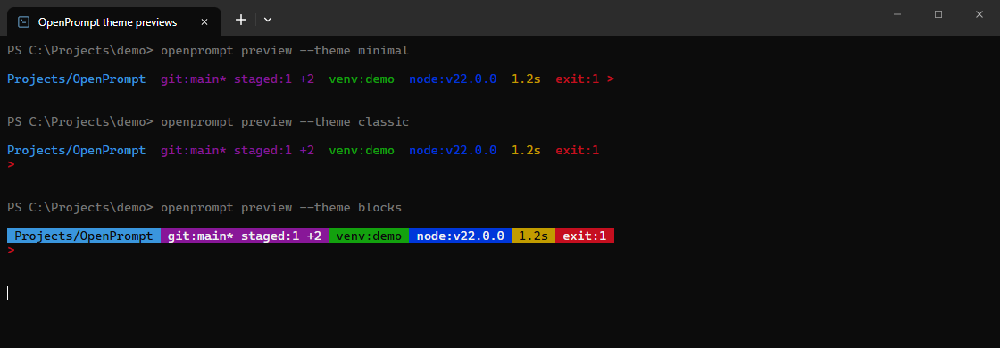

# OpenPrompt

A small, configurable command prompt for **PowerShell 7 and Windows PowerShell 5.1**, written in Rust.

OpenPrompt styles the text **inside** your terminal. It does not replace PowerShell
or provide a terminal window. Use it with OpenTerminal, Windows Terminal, VS Code,
or another ANSI-capable terminal.

```text
~\Projects\OpenPrompt  git:main*  1.2s
>
```

**v0.2:** theme previews and selection, configurable colors/symbols/order, contextual
runtime/environment/session segments, detailed Git counts, bounded caches, and
release packaging. Bash/Zsh integrations are not implemented yet.

## See it in action



Real ANSI output from `openprompt preview --theme <name> --json`, rendered in
OpenTerminal's browser screenshot harness. The directory, Git branch, environment,
runtime and failure are deterministic demo data, not a live project or benchmark.
No terminal-specific integration is required; colors depend on your terminal palette.

```powershell
openprompt preview --theme minimal
openprompt preview --theme classic
openprompt preview --theme blocks
```

Reading the example:

| Segment | Example | Meaning |
| --- | --- | --- |
| Directory | `Projects/OpenPrompt` | Current working directory |
| Git | `git:main* staged:1 +2` | Branch, dirty tree, one staged entry, two commits ahead |
| Environment | `venv:demo` | Active demo environment (preview label) |
| Runtime | `node:v22.0.0` | Detected project runtime (sample version) |
| Duration | `1.2s` | Previous command duration |
| Status | `exit:1` | Previous command failed |

Preview labels are fixed samples; actual Python/Conda environments use `env:name`.

## Install from source

Requirements: stable Rust, Cargo, PowerShell. Git is optional (only the Git segment needs it).
On Windows, Rust's MSVC toolchain also requires Visual Studio C++ Build Tools and the Windows SDK.

```powershell
git clone https://github.com/Andrey89711/OpenPrompt.git
cd OpenPrompt
cargo install --path . --locked
openprompt --version
```

Cargo installs the executable in `~/.cargo/bin`. Ensure that directory is in your `PATH`.
No administrator privileges are required.

## Try it without changing your profile

```powershell
Invoke-Expression (& openprompt init powershell | Out-String)
```

Return to the original prompt in this session:

```powershell
Disable-OpenPrompt
```

Initialization embeds the executable's absolute path, including paths with spaces,
apostrophes, and Unicode characters. It does not download or execute remote scripts.
Review the integration before evaluating it if desired:

```powershell
openprompt init powershell
```

### Enable on every start

Back up your PowerShell profile, then **manually** add this line to `$PROFILE`:

```powershell
Invoke-Expression (& openprompt init powershell | Out-String)
```

OpenPrompt never edits your profile automatically. Remove the line to uninstall
the integration. Do not initialize Oh My Posh or Starship alongside OpenPrompt;
whichever replaces `prompt` last takes over.

## Themes

```powershell
openprompt themes
openprompt preview
openprompt preview --theme blocks
openprompt theme set blocks
openprompt render --theme minimal
openprompt render --theme classic
openprompt render --theme blocks
```

| Theme | Appearance |
| --- | --- |
| `minimal` | One compact line |
| `classic` | Context above the input line (default) |
| `blocks` | Colored background blocks above the input line |

No special font is required by default. For optional icons, install and select a
Nerd Font in your terminal, then set `icons = true`. OpenPrompt does not install fonts.

`preview` uses deterministic sample data with a Git branch, staged file, failed
command, duration, environment, and Node version. It never runs project tools.
`preview --theme classic --json` returns `{theme, ansi, text}` for safe integrations.
The ANSI output is terminal text, not HTML.

### Customize without editing TOML

For a compact prompt, preview first, then explicitly save your choice:

```powershell
openprompt preview --theme minimal
openprompt theme set minimal
```

For colored blocks with custom symbols:

```powershell
openprompt theme set blocks
openprompt style set --success-symbol '>' --error-symbol '!' --layout two-line
openprompt style set --color directory=bright-cyan --color git=magenta
openprompt style set --order session,directory,git,environment,runtime,duration,status
openprompt style set --icons true
```

Layouts: `auto`, `one-line`, `two-line`. Colors: black, red, green, yellow, blue,
magenta, cyan, white, and their `bright-` variants. Symbols accept 1–8 printable
columns. Segment names omitted from `--order` are hidden. Icons still require a
compatible font. `theme set` and `style set` preserve comments/unrelated settings,
validate the whole document, and use atomic replacement; they do not repair invalid
existing configurations or edit symlink files.

## Configuration

```powershell
openprompt config path
openprompt config init
openprompt config check
```

The default file is `~/.config/openprompt/config.toml`, or
`$XDG_CONFIG_HOME/openprompt/config.toml` when that variable is an absolute path.
Missing default configuration uses built-in defaults. `config init` never overwrites
an existing file. Unknown settings and invalid values produce an error.

```toml
theme = "classic" # minimal | classic | blocks
icons = false

[directory]
enabled = true
max_width = 40

[git]
enabled = true
timeout_ms = 300
cache_ms = 1000

[duration]
enabled = true
min_ms = 1000

[status]
enabled = true

[runtime]
enabled = true
timeout_ms = 250

[environment]
enabled = true

[session]
enabled = true

[prompt]
success_symbol = ">"
error_symbol = ">"
layout = "auto"

[colors]
directory = "cyan"
git = "magenta"
success = "green"
error = "red"

[segments]
order = ["session", "directory", "git", "environment", "runtime", "duration", "status"]
```

Preview an alternative configuration with `openprompt --config ./custom.toml render`.
To use it in the shell integration, initialize with that configuration:

```powershell
Invoke-Expression (& openprompt --config ./custom.toml init powershell | Out-String)
```

The file location is converted to an absolute path during initialization.

### Try a complete example without overwriting your settings

From a checkout of this repository, use the included
[`docs/examples/compact.toml`](docs/examples/compact.toml):

```powershell
openprompt --config .\docs\examples\compact.toml config check
openprompt --config .\docs\examples\compact.toml preview --theme minimal
openprompt --config .\docs\examples\compact.toml render --fresh
```

The example uses a single line, cyan directory, Git information and `!` for errors;
runtime/environment segments are hidden. `preview` supplies sample context, while
`render` reads your actual directory and Git state. These commands do not enable
the prompt or edit your default configuration. To try it in the current session:

```powershell
Invoke-Expression (& openprompt --config .\docs\examples\compact.toml init powershell | Out-String)
# Restore the original prompt when done
Disable-OpenPrompt
```

### Segment behavior

- **Directory:** shortens the home directory to `~` and truncates long paths.
- **Git:** branch (or short detached commit), `*` for changes, `staged:N`,
  `modified:N`, `new:N`, `conflicts:N`, `+N` ahead, `-N` behind the configured upstream.
  Counts describe status entries, not changed lines. No network requests.
  Internal submodule changes are skipped.
- **Status:** `exit:N` for an unsuccessful command; the input symbol also turns red.
  PowerShell cmdlet failures may only provide a success/failure flag, not a native exit code.
- **Duration:** elapsed execution time from PowerShell command history, not idle time.
  Hosts that do not provide history omit it; repeated prompts may reuse the last history entry.
- **Runtime:** Node for `package.json`, Python for `pyproject.toml`/`requirements.txt`/
  `Pipfile`/`.python-version`, Rust for `Cargo.toml`/`rust-toolchain.toml` in the
  working directory or up to 12 ancestors. Probes use trusted executables in
  absolute PATH entries, not project scripts. All uncached probes share a budget.
  Probes run outside the project: Python isolated mode disables startup modules,
  Node preload options are removed, and rustup automatic toolchain downloads are
  disabled. Rust shows the selected non-project/default toolchain, not necessarily
  a repository's override. A slow or missing tool is simply omitted.
- **Environment:** active `VIRTUAL_ENV` basename or `CONDA_DEFAULT_ENV` as `env:name`.
- **Session:** `ssh` from SSH environment variables; `admin` from a Windows token
  check at PowerShell initialization. This marker is only a display hint, not an
  authorization check; it is not evidence of elevated privileges for other code.

Git output is bounded to 64 KiB and checks have a configurable time budget. Missing
Git, inaccessible repositories, or timeout simply omit the segment. Rendering still
starts a native process each time; performance depends on your machine and repository.
Repositories exceeding the Git output limit omit that segment rather than showing
inaccurate partial counts. Filesystem operations (especially on network shares)
are not protected by a hard end-to-end timeout; process budgets are not a guarantee
that an unavailable drive cannot stall the operating system.

### Cache and latency

Git results can be reused for `git.cache_ms` (default 1000, maximum 5000). Changes
to HEAD/index invalidate ordinary-repository entries; worktrees/gitfiles and working
file changes can remain stale until TTL expiry. Set `cache_ms = 0` or use
`openprompt render --fresh` for fresh Git data. Successful runtime version probes
are cached for up to 60 seconds with executable metadata/toolchain verification;
failed probes are not cached. Runtime cache bypass is not implied by `--fresh`.

```powershell
openprompt cache clear
.\scripts\benchmark.ps1 -Executable .\target\release\openprompt.exe -Path . -Iterations 20
```

Caches live under the OS cache directory in `openprompt/git-v1` and
`openprompt/runtime-v1`. They persist local paths, branch names, executable metadata,
and version labels, not project file contents. Caching is best effort and can be
unavailable on read-only hosts. `cache clear` deletes recognized cache files only.
See [benchmark methodology and distribution](docs/distribution.md).
Measured local results and limitations are recorded in [performance notes](docs/performance.md).

`--no-color`, the presence of `NO_COLOR`, or `TERM=dumb` disables ANSI colors.
Directory and branch names have terminal control and bidirectional control characters removed.
Colors are reset after every segment. Width fitting is Unicode-aware, but font/emoji
display width can still differ between terminal implementations.

## Reliability

The integration preserves `$LASTEXITCODE`, restores any temporary output-encoding
change, and falls back to a plain `PS path> ` if the renderer fails. Non-filesystem
PowerShell providers use the plain fallback. No background daemon or network service.

OpenPrompt currently targets PowerShell. The Rust CLI builds on Linux/macOS too;
PowerShell must still be installed to use the integration there. Native Bash/Zsh
escaping and shell integrations are separate future work.

## Development and tests

```powershell
cargo fmt --check
cargo clippy --all-targets -- -D warnings
cargo test --locked
cargo build --release --locked
.\scripts\test-powershell.ps1 -Executable .\target\release\openprompt.exe
```

Rust tests cover configuration, rendering, control-character handling, Unicode,
width fitting, CLI commands, and a temporary Git repository. PowerShell integration
tests run isolated `-NoProfile` child shells; they do not modify your profile.

The release executable is `target/release/openprompt.exe` on Windows.
Unlike a desktop GUI, this is intentionally a console CLI: call it from your shell,
not by double-clicking the executable.

## Roadmap

- Bash and Zsh integration, with correct nonprinting-character markers.
- Additional shell hosts, network-drive testing, and more performance measurements.
- Package-manager submissions after verified releases and manifest review.

## Independent terminal applications

OpenPrompt is installed and configured separately from your terminal.
[OpenTerminal](https://github.com/Andrey89711/OpenTerminal) does not bundle,
discover, or initialize it automatically. Initialize OpenPrompt yourself in
PowerShell using the commands above, in OpenTerminal or any other compatible
terminal. A profile-based initialization belongs to PowerShell and can apply
across terminal applications. Install/select a Nerd Font yourself if you enable icons.

## Releases and installation

Version tags trigger Windows/Linux/macOS archive builds and SHA256 checksums.
See [distribution instructions](docs/distribution.md) for verified local ZIP
installation and release automation. Binaries are not code-signed or notarized.
Scoop/WinGet publication requires separate validated submissions; those listings
are not claimed here.

## License

[MIT](LICENSE), copyright (c) 2026 Andrey89711.
Dependency licenses remain applicable to their respective code.
